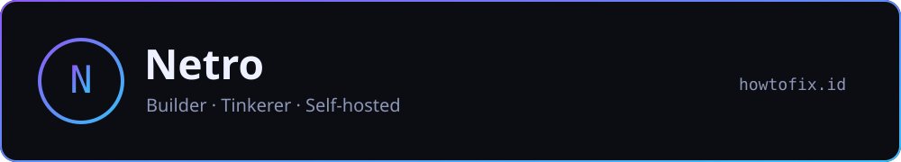

# Netro

[GitHub](https://github.com/shadowheads) · [Website](https://howtofix.id)

---

## 关于我

我热衷于构建自托管的 API 网关、代理池与开发者工具。
喜欢把网页服务改造成 OpenAI 兼容接口，也喜欢研究代理出口与网络指纹。

- 📍 Indonesia
- 🌐 [howtofix.id](https://howtofix.id)
- 🛠️ Python · Go · JavaScript · Rust

## 技术栈

## GitHub 数据

## 最近在做的事

- 让单个服务提供多个代理出口，同时支持 HTTP CONNECT 与 SOCKS5
- 按账号生成独立的浏览器指纹，跟随代理出口的地理位置
- 把各种网页 AI 服务收敛成统一的 OpenAI 兼容入口

## 联系方式

通过 GitHub Issues 或 [howtofix.id](https://howtofix.id) 联系我。

---

*持续构建，保持好奇。*

